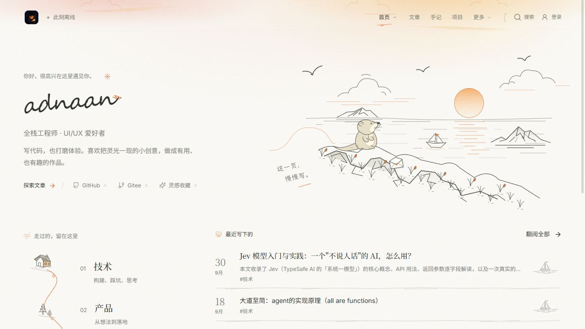
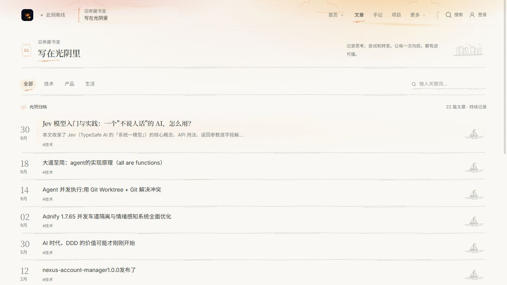
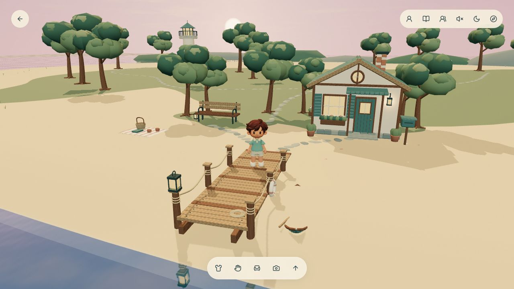

<p align="center">
  
</p>

<h1 align="center">光阴副本</h1>

<p align="center">如果回忆能够誊写，那光阴便有了副本。</p>
<p align="center"><strong>Tidepage</strong> · 一个关于记录、阅读与陪伴的博客主题</p>
<p align="center">
  <a href="#设计思路">设计思路</a> ·
  <a href="#在这里读写与停留">项目体验</a> ·
  <a href="#本地运行">本地运行</a> ·
  <a href="docs/deployment.md">部署文档</a>
</p>



光阴副本是 adnaan 的个人博客，记录技术、设计与日常；**Tidepage** 是这套博客主题的英文名。

有些经历过去了，就很难再完整地记起来。写下一段文字，保存一张照片，或者记下一个尚未想清楚的念头，都是给当时的自己留一份副本。这里既收下认真展开的问题，也容得下试错的过程、做了一半的作品，和某天偶然听见的一首歌。

这个项目从这样的记录习惯出发：让内容有各自适合的表达方式，也让来访的人感受到页面背后是一个具体的人。阅读之外，还有一片海岸和一只水獭，留给暂时不想赶路的时候。

## 设计思路

### 像翻开一本私人手账

Tidepage 用纸白、石墨色、铅笔线条和海岸余晖建立视觉基调。微微不规则的分隔线、手绘的选中标记、页边的小注释，让页面带有被书写过的痕迹。水獭、纸船、灯塔和落日反复出现在插画与导航中，把不同栏目连成同一个地方。

排版保留书页的层次：衬线字体用于篇名、栏目和引用，无衬线字体承担正文与操作，手写只留给签名和少量装饰。日期、分类、摘要各有位置；统一版心维持页面之间的秩序，阅读列则控制行长。留白用于分组与停顿，短内容也应有紧凑、完整的构图。

深浅主题沿用同一套视觉语言。白天是纸面与暖光，夜晚是深色书页与月色；文字、线条和控件的对比关系随之调整。

### 让不同的记录保留自己的样子

长文需要连贯的阅读节奏，手记更像随手留下的一页，作品则需要同时交代想法与成果。栏目共享字体、笔触与交互规范，同时根据内容安排不同的版式。

| 栏目   | 留下什么                               |
| ------ | -------------------------------------- |
| 文章   | 把一个问题想清楚，写下方法、过程与判断 |
| 手记   | 收好尚未长成文章的念头和生活片段       |
| 项目   | 记录一个想法怎样成为可以使用的作品     |
| 一言   | 留下一句值得重读的话                   |
| 照片廊 | 保存目光停留过的地方                   |
| 友联   | 连接同样在认真记录的人                 |



### 安静的页面，也要有清楚的回应

交互延续翻页、描线与纸面显影的感觉。列表依次出现，悬停与选中有轻微反馈，弹窗和面板平缓进出；加载、保存和失败都有可感知的状态。动效的设计目标是交代变化、引导视线，让人知道操作已经被接住。

阅读时，进度与工具随页面收拢，正文始终是视觉中心。键盘焦点和操作标签保留，系统开启“减少动态效果”时，位移与持续动画随之收敛。

### 海岸是博客的一部分

首页的海岸插画延伸成可以进入的三维空间。纸船带来航海与探索，海湾让人散步、坐下、挥手，与偶然到来的同行者合照。阅读是一种停留，沿着海边走一走也是。

水獭是这个空间里的小小主人。它与灯塔、小屋、晚霞一起，为文字之外的部分留下可辨认的性格。海岸继续迭代，也和博客里的文章、手记一样，保留慢慢生长的过程。



## 在这里，读、写与停留

**阅读与交流。** 站点提供中英文内容、文章搜索、归档、阅读工具和 RSS。读者可以使用 GitHub 或 Gitee 登录，以自己的头像评论，插入表情，点赞或收藏感兴趣的内容。

**把记录写成页面。** 内容工作台管理文章、手记、项目、照片和站点资料。富文本编辑支持图片上传与裁剪、代码、表格和来源卡片；草稿与公开内容分开，按语言发布。首页介绍、作者头像、社交链接和 SEO 信息在站点设置中维护。接入模型服务后，可在写作时使用润色、翻译和发布前检查。

**让站点有一点生活气息。** 独立实时网关连接网站与桌面助手。Companion 按白名单分享正在使用的软件和歌曲，给来访者一个“此刻在做什么”的窗口。海湾也通过这条实时链路同步同行者与动作。

## 项目结构

博客页面与 HTTP API 使用 **Next.js App Router + React + TypeScript**；内容、身份和互动持久化到 **PostgreSQL**，通过 **Drizzle ORM** 访问。编辑器基于 **Tiptap**，界面过渡使用 **Motion**，三维海岸使用 **Three.js**。

实时功能由 **Socket.IO + Redis** 的独立服务承担。桌面助手使用 **Go + Fyne**，分别构建 Windows、macOS 和 Linux 原生程序。

```text
src/
  app/                  页面路由、HTTP API 与 SEO
  modules/              内容、账号、媒体、互动和世界等业务
  shared/               共享组件、设计基础、文案与通用协议
  widgets/              页头、页脚与工作台外壳
services/realtime/      实时网关
desktop/               原生桌面助手
public/assets/         网页图片、表情、字体、音频与模型
assets/source/         品牌和模型的可编辑制作源
```

界面按业务组织，公共控件与设计变量集中维护；路由负责取数与页面组合。上传内容独立存储，制作源和检查截图不随网页资源部署。详见 [项目架构](docs/architecture.md)、[前端架构](docs/frontend-architecture.md) 与 [素材记录](ASSETS.md)。

## 本地运行

需要 **Node.js 24**、**pnpm 12.16.1** 和 **PostgreSQL**。

```sh
npm install --global pnpm@12.16.1
pnpm install --frozen-lockfile
```

将 `.env.example` 复制为 `.env`，填写 `DATABASE_URL` 和 `SITE_URL`。确认连接的是开发数据库后：

```sh
pnpm run db:check
pnpm run db:migrate
pnpm run dev
```

访问 [中文首页](http://localhost:3000/zh-CN)、[英文首页](http://localhost:3000/en) 或 [内容工作台](http://localhost:3000/zh-CN/admin)。首次部署需自行录入内容；截图中的个人文章不随仓库提供。

使用工作台前，在 `.env` 配置 GitHub 或 Gitee OAuth 应用。回调地址为 `<SITE_URL>/api/v1/auth/github/callback` 或 `/api/v1/auth/gitee/callback`，然后绑定站主：

```sh
pnpm admin:setup --github <你的用户名>
# 也可使用 --gitee，或同时绑定两个平台
```

多人海湾与桌面状态需额外配置 Redis 和实时服务，再运行 `pnpm run realtime`。完整步骤见 [实时服务](docs/realtime.md) 与 [桌面助手](desktop/README.md)。

## 部署与维护

Docker Compose 编排 Web、实时网关和 nginx，连接外部 PostgreSQL 与 Redis。上传文件默认保存在 `storage/uploads`，可通过 `UPLOAD_DIR` 指定持久化目录；数据库和上传目录需要一起备份。

```sh
pnpm run check
pnpm run build
```

| 文档                                         | 内容                                  |
| -------------------------------------------- | ------------------------------------- |
| [部署指南](docs/deployment.md)               | 域名、HTTPS、环境变量、迁移与健康检查 |
| [工作台说明](docs/workbench-development.md)  | 内容模型、发布、媒体与账号            |
| [设计基础](docs/design-system.md)            | 字体、版心、间距、笔触与动效          |
| [海岸与海湾](docs/world.md)                  | 场景操作、维护入口与当前能力          |
| [素材记录](ASSETS.md)                        | 目录、来源、许可与旧 URL 兼容         |
| [旧数据迁移](docs/legacy-mysql-migration.md) | 迁入已有文章与媒体                    |
| [版本记录](CHANGELOG.md)                     | 0.0.1 的发布进展与已知限制            |
